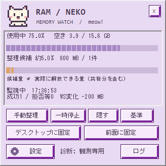

# RAM / NEKO

A tiny Windows memory-monitor gadget with a pixel cat, tactile 8-bit controls, memory charts, conservative cleanup and local logs.



## できること

- 使用中メモリと整理候補を別々のグラフで表示。表示は5秒ごと、低メモリ判定は1分ごと。
- 凸面ボタンはクリック中にへこみ、一時停止・固定の選択中はへこんだ状態を維持。
- **デスクトップに固定**：位置をロックし、通常アプリの背面へ配置。
- **前面に固定**：通常アプリより常に前面へ。2つの固定モードは排他的。
- 8bit設定アイコンからラベンダー・ミント・ピーチ・スカイ・ナイトの5配色を選択。配色・位置・固定モードを再起動後も復元。
- ログ表示、更新、CSV保存。監視・手動整理・結果・配色・固定・表示操作をローカルに記録。
- ネコの通知領域アイコン。×／隠すで収納、ダブルクリックで復帰、右クリックメニューから終了。

デスクトップ固定はWindowsの背面配置と位置ロックです。壁紙への埋込みではなく、Windows+Dなどで非表示になる場合は通知領域から戻してください。[操作の詳細](docs/CONTROLS.md)

## Requirements / 起動

Windows 10/11, Windows PowerShell 5.1, .NET Framework / Windows Forms. Additional packages, image downloads and paid services are not required. Run from a user-writable folder.

```powershell
# Download/clone this repository, then run inside its folder:
wscript.exe //B //Nologo .\LaunchHidden.vbs

# Optional: launch once automatically at this user's next login:
powershell.exe -NoProfile -File .\Install.ps1
```

The login task is `MemoryWatch-PressureOnly`. It starts a hidden launcher once per login; a single PowerShell GUI process uses internal timers. It does not open a new console each minute. A session mutex prevents duplicate panels. No stored password or elevated monitor is required.

The cat icon may appear in Windows' notification overflow area (^). To exit, select **監視を終了** in its menu. Disabling the task only prevents future login starts:

```powershell
Disable-ScheduledTask -TaskName MemoryWatch-PressureOnly
Unregister-ScheduledTask -TaskName MemoryWatch-PressureOnly -Confirm:$false
```

## 整理の基準

`policy.json` contains the conservative candidate standard:

- Chrome / Edge / Firefox in the current session; foreground and last external foreground browser families excluded.
- Process age at least 5 minutes, working set at least 150 MB.
- Observed CPU at most 1% of one logical core for at least 60 seconds. Long sampling gaps reset the observation.
- At most 3 eligible processes per attempt. Failed targets are excluded for 30 minutes in the current run.
- Automatic: available physical memory below both 1536 MB and 10% for 3 consecutive samples; minimum 15 minutes between attempts.
- Manual: same candidate selector, without waiting for pressure, but minimum 60 seconds after any attempt.
- M2 safety increment: selection captures an immutable PID/start-time/name/session identity; native trim validates it on the same handle used for the operation. Unavailable or mismatched identity skips with the existing failure backoff. See [implementation and limits](docs/M2-IDENTITY.md).

**整理候補量は解放保証量ではありません。** It is a gross sum of resident working sets; shared pages can be counted more than once. The results show per-process working-set change, not purported physical RAM freed. CPU inactivity does not prove that a background tab is dispensable. Some browser processes reject the Windows API with access denied; those failures are logged. No browser is terminated, no files are deleted, and the app does not escalate target permissions.

Windows already reclaims working sets as needed. Unconditional periodic RAM purges are not used here. Pages may be faulted back in after trimming, including disk reads. [Microsoft working-set documentation](https://learn.microsoft.com/en-us/windows/win32/memory/working-set), [EmptyWorkingSet](https://learn.microsoft.com/en-us/windows/win32/api/psapi/nf-psapi-emptyworkingset).

## Logs and settings

M1 adds an **observation-only** diagnostic worker (default 60 seconds) and a read-only diagnostics tab under the settings icon. Physical/commit memory, OS low-memory notification, CPU, paging/disk counters, major process snapshots and observer load are recorded with units and missing-data status. These values do **not** change automatic cleanup decisions. Exact hard-fault counts and interaction latency remain explicitly unmeasured. See the [M1 audit, schema, tests and limitations](docs/M1-DIAGNOSTICS.md) and [M2–M4 design](docs/M2-M4-PLAN.md).

`data/diagnostics.jsonl` rotates at a strict 5 MiB plus one backup. Configure observation with `diagnostics.json`; disabling it does not disable the legacy monitor. The main state heartbeat is now written at most once per minute, while display/candidate sampling remains at five seconds. The snapshot is cached; diagnostic collection and its log I/O run on a separate worker. No performance improvement or sustained deployment is claimed by merely obtaining counters.

When diagnostics are enabled in the resident UI, successful trims also schedule observation-only before/after/+30s/+120s records in `data/post-trim.jsonl` (strict 5 MiB + one backup, at most 12 pending attempts). Delayed stages reopen a read-only handle and revalidate identity; missed deadlines, exited/restarted targets and failed APIs are explicit missing observations. Working-set rebound and logical I/O deltas do not establish speed improvement. Paging/disk context is cached and age-labelled. Standalone monitor invocations without an observer do not schedule follow-ups. See [M3 observation schema, tests and limitations](docs/M3-OBSERVATION.md).

Normal runtime files live in `data/`. Monitor/event JSONL logs rotate at 5 MB with one backup each. The viewer and CSV export include retained monitoring, event and post-trim rows, with reasons and signed before/after/rebound changes. Settings show the latest cached follow-up without new collection or file reads. The UI error log now rotates at 5 MiB plus one backup and replaces oversized messages with a short marker; an already oversized legacy error log refuses further appends until archived. Retention depends on size, not days. Preferences store palette, window mode and position. Test/profile data uses isolated directories. Runtime data, test output, exports and local audit records are excluded from Git by a reviewed-file allowlist.

## Tests

```powershell
# Engine, native disposable-process test, logs and off-screen UI tests:
powershell.exe -NoProfile -File .\Test-All.ps1 -SkipInstalled

# Optional ~120-second native follow-up check; trims only its disposable test host:
powershell.exe -NoProfile -File .\Test-PostTrimRealtime.ps1

# Optional isolated, hidden UI profile; no user applications can be trimmed:
powershell.exe -NoProfile -File .\Test-UIProfile.ps1 -Seconds 60

# Also check the installed task and live heartbeat:
powershell.exe -NoProfile -File .\Test-All.ps1
```

The tests exercise candidate filters, pressure/cooldown rules, graph calculations, manual button routing with synthetic data, native pin modes, theme persistence, log export and tray restoration. M1 adds injectable source/clock diagnostics tests and real read-only API checks. Actual native trimming tests touch only disposable test processes. Preview images use synthetic memory values.

See [completion scope and verification boundaries](docs/COMPLETION.md). This review build is not a public release and does not establish improved Windows responsiveness.
